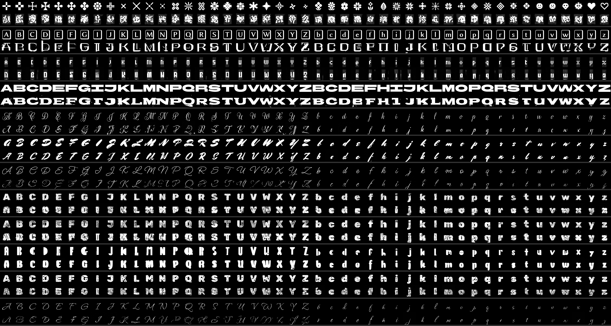

# TypeFaze evaluation

Checkpoint step 40705. 131 held-out test fonts (split by family). The model sees only **H O n a g** from each font and generates the other **47** letters with 4 Euler steps (guidance 2.0). The baseline picks the training font whose H O n a g are closest (pixel L1) and returns its letters.

| | Classifier accuracy | Mean L1 ↓ | Mean SSIM ↑ |
|---|---|---|---|
| Real (ceiling) | 91.5% | 0.000 | 1.000 |
| TypeFaze | 90.8% | 0.031 | 0.867 |
| Nearest-font baseline | 91.2% | 0.028 | 0.884 |

- **Classifier accuracy:** a separate 52-way letter classifier, trained on training fonts only, reads each generated glyph. Higher means more legible. It says nothing about style.
- **L1 / SSIM:** pixel-level and structural similarity to the font's *true* letters. They reward matching the hidden font exactly, so a plausible-but-different design scores low.

## Sibling-family check

12 of 131 test fonts have a sibling family in training (same name after stripping suffixes like Condensed, Display, SC). Scores split by that:

| Test fonts | Count | TypeFaze SSIM | Baseline SSIM |
|---|---|---|---|
| With a training sibling | 12 | 0.864 | 0.901 |
| No training sibling | 119 | 0.867 | 0.883 |

## Worst fonts (by TypeFaze SSIM)

Each pair of rows: the real font's 47 letters, then TypeFaze's attempt.

| Font | TypeFaze SSIM | Baseline SSIM | Training sibling |
|---|---|---|---|
| yarndings20/Yarndings20-Regular.ttf | 0.212 | 0.615 | no |
| libertinuskeyboard/LibertinusKeyboard-Regular.ttf | 0.255 | 0.465 | no |
| micro5charted/Micro5Charted-Regular.ttf | 0.546 | 0.683 | no |
| bbhbartle/BBHBartle-Regular.ttf | 0.587 | 0.547 | no |
| rougescript/RougeScript-Regular.ttf | 0.665 | 0.742 | no |
| mrssheppards/MrsSheppards-Regular.ttf | 0.675 | 0.695 | no |
| msmadi/MsMadi-Regular.ttf | 0.685 | 0.716 | no |
| rubikmarkerhatch/RubikMarkerHatch-Regular.ttf | 0.693 | 0.783 | no |
| rubikdirt/RubikDirt-Regular.ttf | 0.698 | 0.837 | no |
| palettemosaic/PaletteMosaic-Regular.ttf | 0.715 | 0.735 | no |
| rubikgemstones/RubikGemstones-Regular.ttf | 0.731 | 0.811 | no |
| waterfall/Waterfall-Regular.ttf | 0.734 | 0.789 | no |
